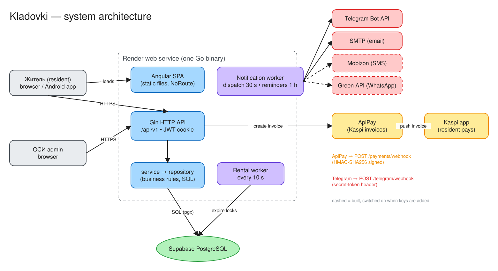
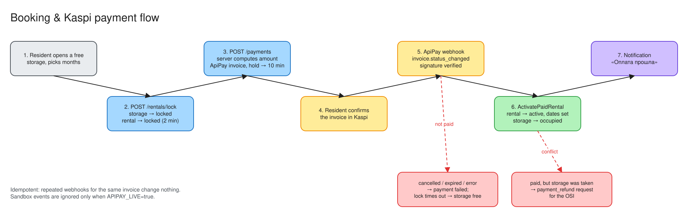
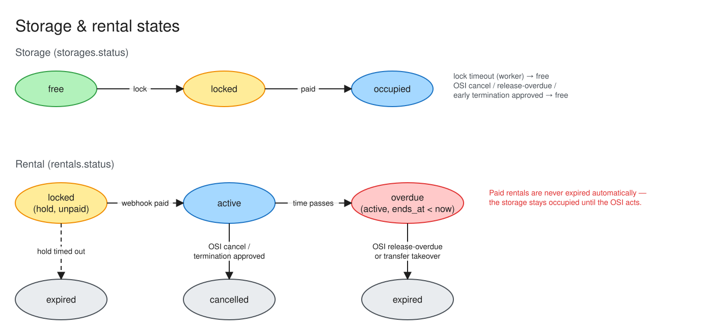
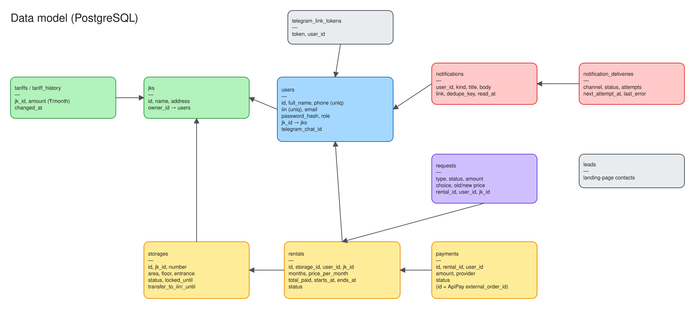
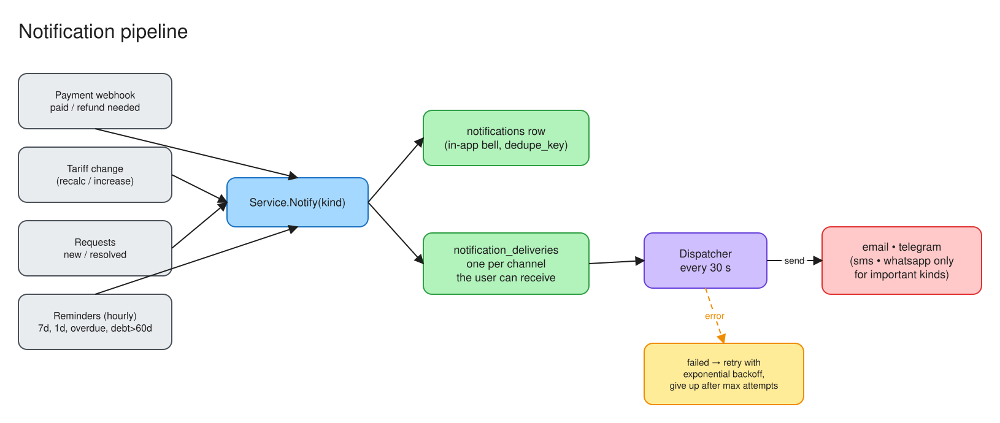
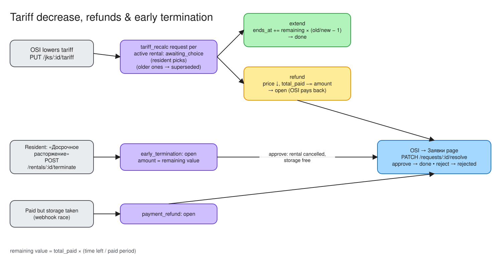

# Kladovki — documentation

Kladovki is a web + Android app for renting storage rooms (кладовки) in residential complexes (ЖК) in Kazakhstan.
Residents find a free storage room, book it and pay through **Kaspi** (via ApiPay).
The building's management (**ОСИ**, the admin) manages storage rooms, the tariff, debts and requests.

| Document | What's inside |
|---|---|
| [architecture.md](architecture.md) | High-level design: components, request flow, background workers, tech stack |
| [domain.md](domain.md) | Glossary, roles, and the business rules (booking, payment, rental lifecycle, tariff changes, refunds, transfer) |
| [api.md](api.md) | Every REST endpoint: method, path, who may call it, body |
| [data-model.md](data-model.md) | Database tables, statuses, relations, migrations |
| [payments.md](payments.md) | ApiPay / Kaspi integration, webhook security, failure cases |
| [notifications.md](notifications.md) | In-app, email, Telegram, SMS, WhatsApp — how messages are produced and delivered |
| [security.md](security.md) | Authentication, roles, ЖК isolation, secrets |
| [operations.md](operations.md) | Running locally, tests, CI, deploy to Render, environment variables, runbook |

## Diagrams

Diagrams live in [`diagrams/`](diagrams/). Each one has two files:

- `*.excalidraw`: the editable source. Open it at [excalidraw.com](https://excalidraw.com) (File → Open), or in VS Code with the Excalidraw extension.
- `*.svg`: a preview that GitHub renders. **After you edit a `.excalidraw` file, re-export the SVG** (Export image → SVG) and save it next to the source.

| | |
|---|---|
|  |  |
|  |  |
|  |  |

## Repository layout

```
backend/                 Go API server (gin) — also serves the built Angular app
  cmd/server/main.go     entry point: config → DB → service → router → workers
  internal/config        env loading (.env.local, .env, Render secret files)
  internal/database      connection + idempotent migrations
  internal/handlers      HTTP layer: routing, auth checks, JSON in/out (+ integration tests)
  internal/middleware    JWT auth, admin / same-ЖК guards
  internal/service       business rules, workers, notifications
  internal/repository    SQL (one file per aggregate)
  internal/models        structs shared by the layers
  internal/notify        delivery channels: email, Telegram, SMS, WhatsApp
frontend/                Angular 22 SPA + Capacitor Android shell
  src/app/core           auth, services (HTTP), models, pure display utils (+ specs)
  src/app/features       landing, auth, admin (ОСИ) pages, client (resident) pages
docs/                    you are here
.github/workflows/ci.yml backend + frontend tests on every PR
```
