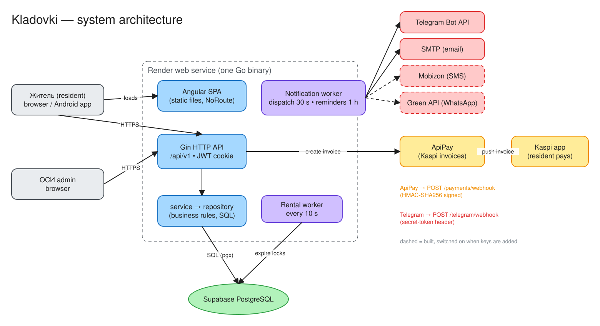

# Architecture



## In one paragraph

A single Go binary runs on Render. It serves the REST API under `/api/v1` and the built Angular SPA for every other path. All state lives in one PostgreSQL database on Supabase. Two background goroutines run inside the same process: one expires unpaid holds, the other delivers notifications and sends reminders. Kaspi payments go through ApiPay: we create an invoice, the resident pays in the Kaspi app, and ApiPay calls our signed webhook. The Android app is the same SPA wrapped with Capacitor.

## Components

| Component | Tech | Responsibility |
|---|---|---|
| SPA | Angular 22 (standalone components, signals), Tailwind 4 | Resident pages (`/app/...`) and ОСИ admin pages (`/admin/...`), login and registration |
| Android app | Capacitor 8 | Wraps the SPA and talks to the same API |
| HTTP API | Go 1.25, gin | Auth, validation, access control, JSON |
| Service layer | Go | Business rules: booking, payments, tariff recalculation, requests, notifications |
| Repository | `database/sql` + pgx | SQL, with transactions for every multi-row state change |
| Rental worker | goroutine, every **10 s** | Expires unpaid `locked` rentals and frees their storage rooms |
| Notification worker | goroutine | Dispatches pending deliveries every **30 s** and runs reminder rules every **hour** |
| Database | PostgreSQL (Supabase) | Single source of truth; schema migrated on startup |
| ApiPay | external | Creates Kaspi invoices; sends `invoice.status_changed` webhooks |
| Telegram / SMTP / Mobizon / Green API | external | Notification channels. Each one turns on only when its keys are set |

## Layering

```
HTTP request
  → middleware.Optional / Require (JWT from cookie or Authorization header)
  → RequireAdmin (admin routes)          ← role check
  → handler: parse body, SameJK / storageInMyJK / canSeeRental   ← ownership checks
  → service: business rules, events → notifications
  → repository: SQL in a transaction
```

Rules of thumb used across the code:

- **Handlers decide who may call; services decide what is allowed.** For example, "is the tariff lower?" is a service rule, while "is this admin from this ЖК?" is a handler rule.
- **The server computes every amount of money.** The client never sends a price.
- **State changes that touch several rows** (storage + rental + payment) run in one transaction, with `SELECT … FOR UPDATE` where there is a race.
- **Errors**: repository sentinel errors (`ErrNotFound`, `ErrLocked`, `ErrAlreadyExists`, …) map to 404 / 409 / 400 in handlers. Messages shown to users are in Russian.

## Request flow example: booking

1. `POST /api/v1/rentals/lock` puts the storage room in `locked` and creates a rental in `locked` state with a 2-minute hold.
2. `POST /api/v1/payments` makes the server compute `price × months`, create the ApiPay invoice, and extend the hold to 10 minutes.
3. The resident pays in Kaspi.
4. ApiPay calls `POST /api/v1/payments/webhook` (HMAC-signed). The server sets the rental to `active` and the storage room to `occupied`, then sends a notification.

Details: [payments.md](payments.md), [domain.md](domain.md).

## Background work

| Job | Interval | What it does |
|---|---|---|
| `StartRentalWorker` | 10 s | `locked` rentals past `ends_at` become `expired`; storage rooms stuck in `locked` with no live hold become `free`. **Paid rentals are never expired automatically.** |
| `DispatchPending` | 30 s | Sends due `notification_deliveries`. On failure it retries with exponential backoff (the wait doubles each time, in minutes), up to 6 attempts |
| `RunReminders` | 1 h | Sends reminders 7 days and 1 day before the rental ends, an overdue notice (immediately, then weekly, to both the resident and the ОСИ), and a warning when debt is older than 60 days. Deduplicated per rental and period |

The workers run inside the web process. If Render ever runs more than one instance, the jobs are still safe: every update is conditional, and notifications are deduplicated by `(user_id, dedupe_key)`. They would just run twice as often.

## Startup sequence (`cmd/server/main.go`)

1. `config.Load()` reads env files (`.env.local`, `/etc/secrets/.env.local`, `.env`, `/etc/secrets/.env`) and the process environment. Real env vars win.
2. `database.Open` connects and runs the idempotent migrations.
3. It builds the services, sets up the notification channels from env, and creates the token service and middleware.
4. It registers the gin routes, adds CORS (localhost:4200, capacitor `https://localhost`, `*.onrender.com`) and the SPA fallback.
5. It starts the workers. If Telegram is configured, it registers the bot webhook at `APP_BASE_URL/api/v1/telegram/webhook`.
6. It starts the HTTP server with graceful shutdown on SIGINT/SIGTERM.

## Tech choices and why

| Choice | Why |
|---|---|
| One binary serving the API + SPA | One Render service, no CORS in production, simple deploys |
| Postgres enums for core statuses | Mirrors the production schema created early in the project; invalid states are rejected by the DB |
| `VARCHAR` status for newer tables (requests, notifications) | Adding a new value needs no `ALTER TYPE` migration |
| In-process workers instead of a queue | Low volume; the DB tables (`notification_deliveries`) act as the durable queue |
| Integration tests on a real Postgres | Most bugs were SQL or state-machine bugs, which mocks wouldn't catch |
