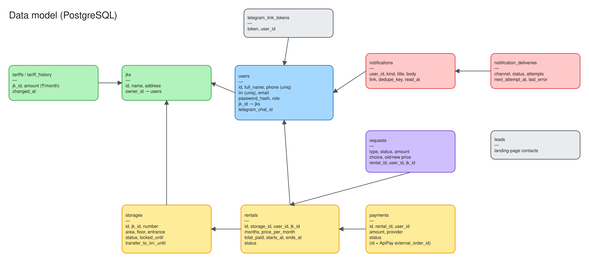

# Data model



Schema source: [`backend/internal/database/database.go`](../backend/internal/database/database.go). Migrations are a list of **idempotent** SQL statements (`CREATE … IF NOT EXISTS`, `ADD COLUMN IF NOT EXISTS`, guarded `DO $$` blocks) that run on every startup. They match the production schema, which was checked against a production dump. **Never edit an old statement: append a new one.**

IDs are UUID strings (`VARCHAR(36)`). Money is `BIGINT` whole tenge. Times are `TIMESTAMPTZ`.

## Tables

| Table | Purpose | Key columns |
|---|---|---|
| `jks` | Residential complexes | `name`, `address`, `owner_id → users` |
| `users` | Residents and ОСИ admins | `phone` UNIQUE, `iin` UNIQUE (when set), `email`, `password_hash` (bcrypt), `role` (`user_role`), `jk_id → jks`, `telegram_chat_id` |
| `storages` | Storage rooms | `jk_id`, `number` (unique per ЖК, case/space-insensitive), `area`, `floor`, `entrance`, `status` (`storage_status`), `locked_until`, `transfer_to_iin`, `transfer_until` |
| `tariffs` | Current monthly price per ЖК | `jk_id`, `amount`, `updated_at` |
| `tariff_history` | Every tariff change | `jk_id`, `amount`, `changed_at` |
| `rentals` | One rental of one storage room | `storage_id`, `user_id`, `jk_id`, `months`, `price_per_month`, `total_paid`, `starts_at`, `ends_at`, `status` (`rental_status`) |
| `payments` | Kaspi invoices | `rental_id`, `user_id`, `amount`, `provider` (`apipay`), `status` (`payment_status`). `id` is sent to ApiPay as `external_order_id` |
| `requests` | Заявки | `type`, `status`, `amount`, `choice`, `old_price`, `new_price`, `comment`, `resolution`, `resolved_at`, `resolved_by`, `rental_id`, `user_id`, `jk_id` |
| `notifications` | In-app inbox | `user_id`, `kind`, `title`, `body`, `link`, `dedupe_key` (unique per user), `read_at` |
| `notification_deliveries` | Outbox: one row per notification × channel | `channel`, `status` (`pending`/`sent`/`failed`/`skipped`), `attempts`, `next_attempt_at`, `last_error`, `sent_at` |
| `telegram_link_tokens` | One-time tokens for linking a Telegram chat (1 day) | `token`, `user_id` |
| `leads` | Contact form on the landing page | `full_name`, `phone`, `email` |

## Enums & statuses

| Type | Values |
|---|---|
| `user_role` | `resident`, `admin` |
| `storage_status` | `free`, `locked`, `occupied` |
| `rental_status` | `locked` (hold, unpaid), `active`, `expired`, `cancelled` |
| `payment_status` | `pending`, `success`, `failed` |
| `requests.type` | `tariff_recalc`, `early_termination`, `payment_refund` |
| `requests.status` | `awaiting_choice` (resident must choose), `open` (ОСИ must act), `done`, `rejected`, `superseded` |
| `notifications.kind` | `payment_success`, `rental_expiring`, `rental_overdue`, `debt_warning`, `tariff_changed`, `tariff_recalc`, `request_new`, `request_resolved` |

## Invariants

- At most one live rental (`locked` with time left, or `active`) per storage room. This is enforced in `LockStorage` with row locks.
- `storages.status = occupied` ⇔ there is an `active` rental for it.
- `rentals.total_paid` is what the resident actually paid, minus any refund they chose.
- A notification with the same `(user_id, dedupe_key)` is never created twice. The reminders rely on this.

## Useful queries

```sql
-- Overdue rentals of a ЖК with debt so far
SELECT s.number, u.full_name, u.phone, r.ends_at,
       ceil(extract(epoch FROM now() - r.ends_at) / 86400) AS days_overdue
FROM rentals r JOIN storages s ON s.id = r.storage_id JOIN users u ON u.id = r.user_id
WHERE r.jk_id = $1 AND r.status = 'active' AND r.ends_at < now()
ORDER BY r.ends_at;

-- Open requests the ОСИ still has to handle
SELECT type, amount, created_at FROM requests WHERE jk_id = $1 AND status = 'open';

-- Notification deliveries that keep failing
SELECT channel, attempts, last_error FROM notification_deliveries WHERE status = 'failed' ORDER BY created_at DESC LIMIT 20;
```
