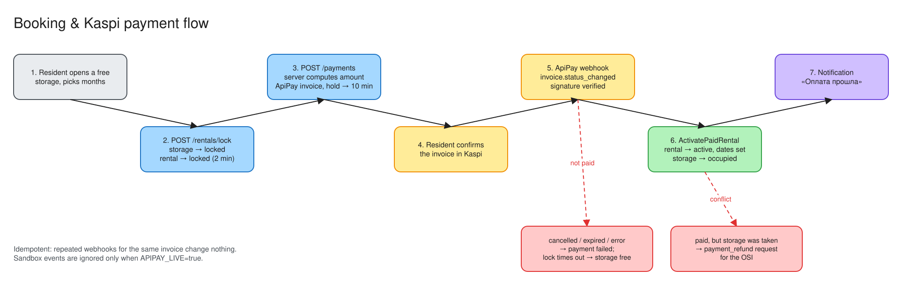
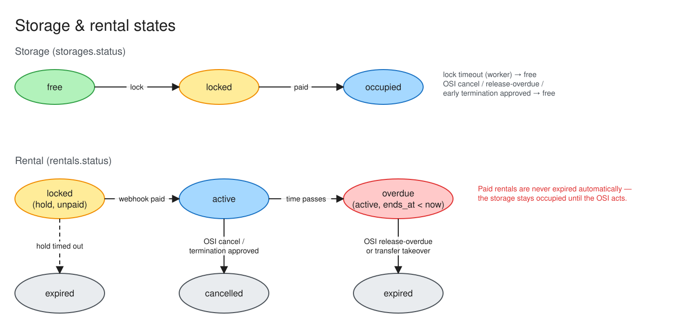
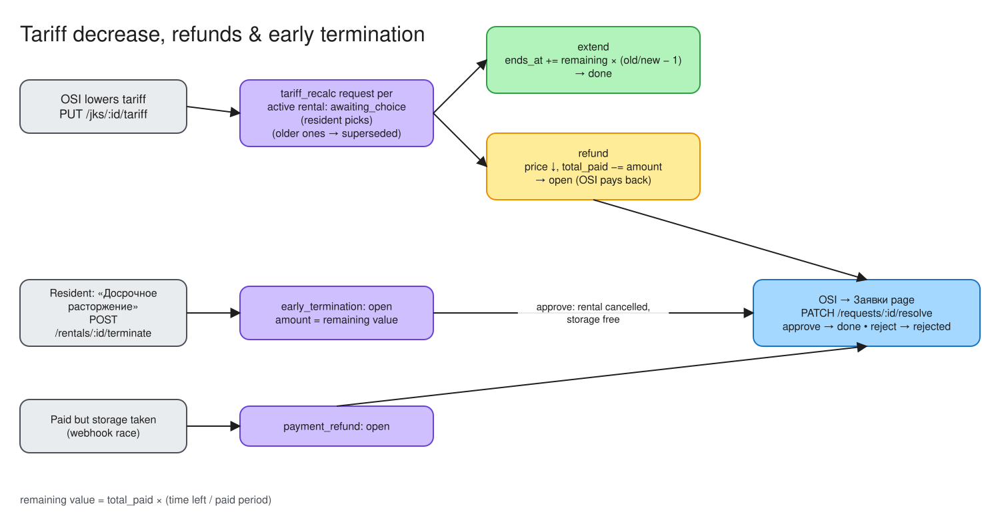

# Domain & business rules

## Glossary

| Term | Meaning |
|---|---|
| **ЖК** (`jks`) | Residential complex. Everything (storage rooms, tariff, users, requests) belongs to exactly one ЖК |
| **ОСИ** | Building owners' association, the **admin** role. One ОСИ admin manages one ЖК |
| **Житель** | Resident, the **resident** role. Rents storage rooms in their own ЖК |
| **Кладовка** (`storages`) | A storage room: number, area (м²), floor, entrance |
| **Аренда** (`rentals`) | A rental of one storage room by one resident for N months at a fixed monthly price |
| **Тариф** (`tariffs`) | Monthly price in ₸ **per m²** in this ЖК. A room's monthly price = `round(area × tariff)`, fixed into the rental when it is booked or renewed |
| **Заявка** (`requests`) | Something the ОСИ must act on, or a resident must answer (refund, early termination, tariff choice) |
| **Долг** | Money owed for an overdue rental (time used after `ends_at` × tariff) |
| **ИИН** | 12-digit Kazakh personal ID number, used as the resident's login |

## Roles

| | Resident (`resident`) | ОСИ (`admin`) |
|---|---|---|
| Sees | storage rooms of their ЖК, **their own** rentals, payments, requests, notifications | everything in **their** ЖК |
| Can | book + pay, choose extend/refund, ask for early termination, name a successor (transfer) | create, edit and delete storage rooms; set the tariff; cancel or release rentals; resolve requests; see dashboards |
| Logs in with | ИИН (also phone / email) | phone / email / ИИН |

Users of one ЖК can never see or change anything in another ЖК. See [security.md](security.md).

## User agreement (consent)

- The product owner wrote two agreements in Russian and Kazakh: **«Пользовательское соглашение и правила аренды кладовых»** for residents, and **«Регламент использования сервиса для ОСИ»**. They live in `backend/internal/legal/texts/`, can be read at `/terms/resident_terms` and `/terms/osi_rules`, and are linked from the profile and from Настройки.
- **Residents** tick «Я принимаю…» at **registration** and at **every payment and renewal**. Per the product owner, that tick at payment *is* the rental contract. The checkbox opens the full text with a Русский / Қазақша switch.
- **ОСИ** see a full-screen prompt in the admin panel until they accept the current version of the regulation.
- Each acceptance is stored in `agreement_acceptances` with user, document, version, context (`registration`/`payment`/`renewal`/`prompt`), rental, IP, browser and time, as evidence.
- **Changing a text:** edit the file and bump its version in `legal.go`. Residents accept the new version at their next payment; ОСИ are prompted again.

## Who may rent

Per the user agreement (п. 2.1), only **owners of a flat or commercial premises** in the ЖК may rent. This covers individuals and companies; one owner may rent several rooms. Flat tenants and outsiders may not.

- At registration the user states **what they own**: a flat or commercial premises, and its number. They also say whether they act as a person or **represent a company**. A company representative adds the company's **БИН** (12 digits) and name; the ИИН stays the representative's own. An ИП registers as a person, since its БИН is the ИИН.
- The account starts as **pending**: they can log in and browse, but booking and renewal are refused (403).
- The ОСИ checks them on **Жители** (`/admin/residents`):
  - **Подтвердить**: the user becomes `active`;
  - **Отклонить**: a reason is required, and the user sees it, fixes the data, and resubmits;
  - **Заблокировать**: existing rentals stay, but no new bookings or renewals.
- Users who existed before this feature are `active`.
- **Later:** an automatic ownership check via egov.kz (п. 2.2), replacing the manual check.

## Registration & login (IIN flow)

1. The ОСИ prints the QR code from **Настройки**. It links to `/login?jk=<jk_id>`.
2. The resident types their ИИН. The app calls `POST /auth/iin-status`.
   - **Known ИИН**: ask for the password.
   - **Unknown ИИН**: go to `/auth/register?iin=…&jk=…`, the "Вы впервые входите в систему. Придумайте пароль." screen. It asks for name, phone, password and the password again.
3. The ЖК comes from the QR link. If there is no `jk` and the system has exactly one ЖК, that one is used.
4. Validation: the ИИН must be exactly 12 digits (the checksum is not verified yet), the password at least 6 characters, and the phone and ИИН unique. Errors are in Russian.

No password-reset flow exists yet. The login page tells residents to contact the ОСИ.

## Booking & payment



| Step | Rule |
|---|---|
| Lock | Only a `free` storage room can be locked. The hold lasts the ЖК's **lock duration**: set by the ОСИ in Настройки (1–60 min, default 2; `jks.lock_minutes`). A second resident gets 409 "ожидается подтверждение оплаты" |
| Invoice | `POST /payments` with `rental_id` (+ optional Kaspi phone). The amount is `price_per_month × months`, **computed on the server**. The hold is extended to **10 minutes** (`service.PaymentWindow`) |
| Paid | The webhook sets the rental to `active`, `starts_at = now`, `ends_at = now + months`, `total_paid = amount`, and the storage room to `occupied`. Repeated webhooks are no-ops |
| Paid late | If the hold expired but the storage room is still free, the rental is activated anyway |
| Paid, room taken | The rental is not activated. A **payment_refund** request is opened for the ОСИ |
| Not paid | Invoice `cancelled` / `expired` / `error` → payment `failed`. The hold runs out → storage room `free` |

## Rental lifecycle



- **Overdue** is not a separate status. It is an `active` rental whose `ends_at` has passed. The storage room stays `occupied` (the resident's things are inside). Reminders and debt warnings go out, and the ОСИ decides what to do.
- ОСИ actions:
  - **cancel** (any active rental);
  - **release-overdue** (rental → `expired`, room → `free`);
  - **force-release** (clear a stuck hold).
- The UI shows an unpaid expired hold as "Бронь истекла". The cost of a hold is shown as `price × months`; once paid, it's `total_paid`.

## Renewal (продление)

- Any **active** rental can be renewed by its tenant, **overdue included**: «Оплатить продление» on the rental page → choose 1/3/6/12 months → Kaspi invoice (`POST /rentals/:id/renew`).
- The price is the **current** tariff: `round(area × tariff) × months`. After payment the rental's `price_per_month` becomes that price.
- When paid: `ends_at += months` **from the current end date**, not from today. An overdue tenant therefore pays for the overdue time first. `total_paid += amount`, `months += months`.
- Not allowed while a transfer to a successor is pending (409).
- If the rental was ended (cancelled or released) before the money arrived, it is not revived. A `payment_refund` request is opened instead.

## Remaining value

Several rules need "how much of what was paid is still unused":

```
remaining value = total_paid × (time left until ends_at / whole paid period)
```

## Tariff change



- **Increase**: existing rentals keep their price until they end. Residents get a `tariff_changed` notification.
- **Decrease**: before saving, the ОСИ sees a preview: how many rentals are affected and the total difference (`GET /jks/:id/tariff/preview?amount=`). When saved, each active rental with time left gets a **tariff_recalc** request in status `awaiting_choice`. Older unanswered ones become `superseded`. The resident picks one of two options:
  - **extend**: the remaining time is stretched to the new price, `ends_at += remaining_time × (old/new − 1)`. Applied immediately, request `done`.
  - **refund**: `price_per_month = new`, `total_paid −= remaining value × (1 − new/old)`. The request becomes `open`, and the ОСИ returns the money and marks it done.

## Early termination

- The resident clicks «Досрочное расторжение» (with an optional comment). This creates an **early_termination** request (`open`) with `amount` = remaining value. Only one open request per rental is allowed.
- The ОСИ can **approve**: the rental becomes `cancelled`, `ends_at = now`, the storage room becomes `free`, and the ОСИ refunds the amount. Or **reject**, with a comment.

## Transfer to another resident (by ИИН)

- The current tenant (or the ОСИ) sets `transfer_to_iin` on the storage room. `transfer_until` = rental `ends_at` + **14 days**.
- Only the resident with that ИИН can book this storage room. They can do so once the current paid rental has ended and the 14-day window is still open. The old rental then becomes `expired`.

## Storage editing rules

- Room numbers are unique per ЖК (case- and space-insensitive) → 409.
- Number, area, floor and entrance of a room that is not `free` cannot be changed → 409.
- Creating a storage room always uses the admin's own ЖК, whatever the body says.

## Known gaps

- Password reset and eGov/GBD ownership checks aren't built yet.
- Refunds are tracked as requests. The money itself is returned manually by the ОСИ; ApiPay refund isn't automated.
