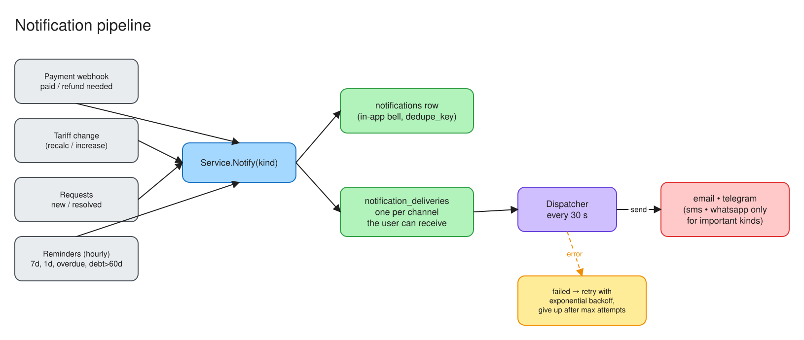

# Notifications



## Model

Every event creates **one** `notifications` row. It shows in the bell icon on both the resident and ОСИ sides. The event also creates one `notification_deliveries` row for each external channel that can reach the user. A dispatcher sends the deliveries and retries them, so a slow or broken provider never blocks an HTTP request.

```
event ─► Service.Notify(user, kind, title, body, link, dedupeKey)
           ├─ INSERT notifications (skipped if (user_id, dedupe_key) exists)
           └─ INSERT notification_deliveries for each reachable channel
DispatchPending (every 30 s) ─► channel.Send() ─► sent | retry (backoff ×2) | failed after 6 attempts
```

## Events

| Kind | When | To | Paid channels? |
|---|---|---|---|
| `payment_success` | Webhook `paid` activated the rental | resident | no |
| `rental_expiring` | 7 days and 1 day before `ends_at` (hourly check) | resident | **yes** |
| `rental_overdue` | `ends_at` passed: once, then weekly | resident + ОСИ | **yes** |
| `debt_warning` | Overdue more than 60 days | resident | **yes** |
| `tariff_recalc` | Tariff lowered: choose extend or refund | resident | **yes** |
| `tariff_changed` | Tariff raised | residents with active rentals | no |
| `request_new` | A new early_termination / payment_refund request | ОСИ | no |
| `request_resolved` | The ОСИ approved or rejected a request | resident | no |

"Paid channels" (SMS, WhatsApp) are used only for the kinds marked **yes**, to keep costs down. In-app, email and Telegram receive everything.

## Channels

| Channel | Provider | Cost | Turn on with | Reaches a user when |
|---|---|---|---|---|
| In-app | our DB | free | always on | always |
| Email | any SMTP (e.g. Gmail + app password, Brevo, Mailjet) | free tier | `SMTP_HOST`, `SMTP_PORT` (587), `SMTP_USER`, `SMTP_PASSWORD`, `SMTP_FROM` | the user has an email |
| Telegram | Bot API | free | `TELEGRAM_BOT_TOKEN`, `TELEGRAM_BOT_USERNAME`, `TELEGRAM_WEBHOOK_SECRET`, `APP_BASE_URL` | the user linked Telegram in their profile |
| SMS | Mobizon (mobizon.kz) | paid per SMS; sender name needs approval | `MOBIZON_API_KEY` (`MOBIZON_API_BASE` optional) | the phone is a valid KZ number |
| WhatsApp | Green API | free developer plan, paid after | `GREENAPI_INSTANCE_ID`, `GREENAPI_TOKEN` | the phone is a valid KZ number |

At startup the server logs `notifications: <channel> channel enabled` for each channel it found.

## Linking Telegram

1. Profile → **Подключить Telegram** → `POST /me/telegram/link`. This returns `https://t.me/<bot>?start=<token>`. The token is single-use and valid for 1 day.
2. The user presses **Start** in Telegram. Telegram calls `POST /api/v1/telegram/webhook` with our secret header. We store `users.telegram_chat_id` and reply "connected".
3. **Отключить** → `DELETE /me/telegram`.

On startup, if `APP_BASE_URL`, the token and the secret are all set, the server registers the bot webhook itself (`setWebhook`).

## Adding a new channel

1. Implement `notify.Channel` (`Name`, `CanReach`, `Send`) in `backend/internal/notify/channels.go`.
2. Add its env vars to `notify.Config` / `ConfigFromEnv` and to `Channels()`.
3. If it costs money, add it to `paidChannels` in `service/notification.go`.
4. Write a test with an `httptest` fake server, like the existing ones in `notify_test.go`.

Possible next channels: **FCM push** for the Android app (free), and the official **WhatsApp Cloud API** (Meta, template messages) for higher volume.
