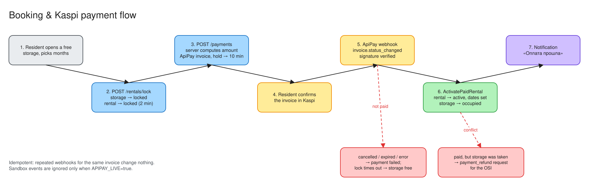

# Payments (ApiPay → Kaspi)



We use [ApiPay](https://apipay.kz) to send Kaspi invoices. The resident receives a push notification in the Kaspi app, confirms the payment, and ApiPay notifies us through a webhook.

## Configuration

| Env var | Meaning |
|---|---|
| `APIPAY_KEY` | API key (`X-API-Key` header). Required for invoices |
| `APIPAY_WEBHOOK_SECRET` | Secret for verifying webhook signatures. **Without it every webhook is rejected** (outside development) |
| `APIPAY_BASE_URL` | Default `https://api.apipay.kz/api` |
| `APIPAY_LIVE` | `true` = real money. Then `is_sandbox: true` events are **ignored**. Leave it empty while testing in sandbox |

In the ApiPay dashboard, set the webhook URL to `https://<host>/api/v1/payments/webhook` and subscribe to `invoice.status_changed`.

## Creating an invoice: `POST /payments`

1. The resident must own the rental, and the rental must be in `locked` state.
2. In `PreparePayment` (one transaction), the server:
   - computes `amount = price_per_month × months`;
   - inserts a `payments` row (`pending`);
   - extends the hold to **now + 10 min**, so the resident has time to open Kaspi.
3. It calls `POST {base}/v1/invoices` with `amount`, `phone_number` (the Kaspi phone; defaults to the profile phone) and `external_order_id = payment.id`, with a 15-second timeout. On failure the response is **502**.

## Webhook: `POST /payments/webhook`

```
X-Webhook-Signature: sha256=<hex(HMAC_SHA256(raw_body, APIPAY_WEBHOOK_SECRET))>
{ "event": "invoice.status_changed", "is_sandbox": false,
  "invoice": { "external_order_id": "<payment id>", "status": "paid" } }
```

Processing:

1. The handler reads the **raw** body and checks the signature with a constant-time compare. If it doesn't match: **401**.
2. Events other than `invoice.status_changed` are ignored (200).
3. When `APIPAY_LIVE=true`, sandbox events are ignored (200).
4. The status decides the outcome:

| Invoice status | Result |
|---|---|
| `paid` | `ActivatePaidRental`: payment → `success`; rental → `active` with `starts_at = now`, `ends_at = now + months`, `total_paid = amount`; storage room → `occupied`; notification `payment_success` |
| `cancelled`, `expired`, `error` | `MarkPaymentFailed`: payment → `failed`. The hold then runs out normally |
| `pending`, `processing`, others | Ignored |

**Idempotency.** A payment that is already `success` is not processed again, so ApiPay can retry safely.

**Race.** If the payment arrives after the hold expired and *someone else* has taken the storage room in the meantime, we don't double-book. A `payment_refund` request (status `open`) is created, and the ОСИ gets a «Нужен возврат оплаты» notification. (The resident is not notified automatically yet; see the known gaps in [domain.md](domain.md).)

## Why it is built this way

Before PR #15 the client sent the amount, webhooks weren't verified, and `/rentals/confirm-payment` was reachable in production. Anyone could rent a storage room for 1 ₸ or without paying at all. Now:

- the amount is computed on the server only;
- every webhook must be signed;
- `confirm-payment` exists only when `APP_ENV=development`.

## Testing

- **Automated.** `backend/internal/handlers/security_test.go` covers wrong or missing signatures, client-supplied amounts, idempotency, the late payment with the storage room taken, and the dev-only route.
- **Manual sandbox.**
  1. Use a sandbox ApiPay key and leave `APIPAY_LIVE` empty.
  2. Book a storage room in the app.
  3. Mark the invoice as paid in the ApiPay sandbox.
  4. Within seconds the rental should become active.

## Going live

1. Get production ApiPay access (paid plan).
2. Put the live key and webhook secret on Render.
3. Set `APIPAY_LIVE=true`.
4. Make one real payment for a small amount, then cancel the rental from the admin panel and refund it manually.
